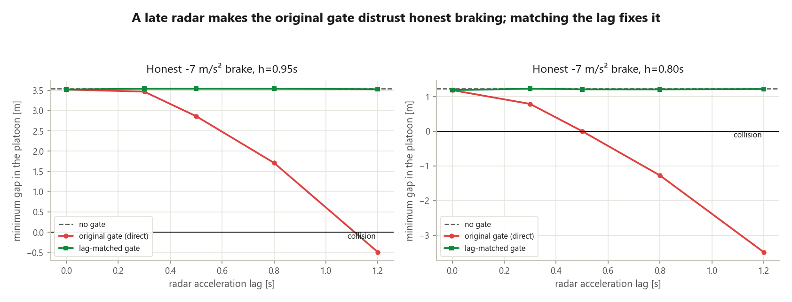

# cacc — string-stability & V2X-robustness test engine for longitudinal vehicle controllers

> Does your ACC / CACC / platooning controller amplify traffic waves? Does it
> stay safe when V2V messages arrive late, get lost, are noisy, or are
> spoofed? Point `cacc` at your controller and a test plan; get a verdict per
> operating condition with reproducible evidence your CI can gate on.

**Who it is for:** ADAS validation and longitudinal-controls engineers, V2X
stack vendors who must show controller-level impact of latency/loss, and
convoy/platooning teams. Why this market, and what comes next:
[`docs/product/P-04`](docs/product/P-04-industry-and-product-strategy.md).

## Key result: the engine caught a flaw in its own spoof defence



A V2V spoof gate that checks messages against the car's radar keeps a
+5 m/s² phantom-throttle attack from causing a crash (8.2 m minimum gap vs
−30.6 m without it). But radar acceleration is *late*. In an honest −7 m/s²
emergency brake at a 0.8 s headway, a 0.3 s radar lag makes the original
gate distrust the early V2V brake message and turns a near miss (0.11 m)
into a collision (−0.26 m). Comparing the radar with the V2V value received
one radar-lag earlier keeps every case within 0.06 m of the ungated
platoon. Reproduce: `python scripts/radar_lag_study.py` (about 2 minutes);
details in [`D-028`](docs/decisions/D-028-realism-fixes-from-the-critique.md).

## Quick start

```bash
pip install -e .                                  # Python >= 3.11, installs the `cacc` command
cacc evaluate examples/plans/smoke.yaml -j 2      # built-in CTHP design       -> PASS
cacc evaluate examples/plans/idm_acc.yaml -j 2    # commercial-style ACC plugin -> FAIL (string-unstable)
cacc stress -c cthp --preset full -j 6            # EV platoon: 6 maneuvers x 15 conditions grid (Pro)
cacc lab --preset cacc -o my.yaml && cacc lab my.yaml   # design a controller from transfer functions
cacc stress -c my.yaml                            # ...and stress-test the design
cacc sweep scenarios/leader_brake.yaml -c acc     # measured |Γ(jω)| per hop
cacc calibrate examples/data/synthetic_openacc_platoon.csv   # digital twin of each car's ACC from a drive log
cacc audit examples/data/synthetic_openacc_platoon.csv       # the customer deliverable: HTML report + release gates
cacc init my-acc                                  # scaffold your own controller project + CI gate
```

## What you get

| capability | where |
|---|---|
| **Bring your own controller** — any Python class as `file.py:Class` or `pkg.mod:Class`; nonlinear laws get raw gap/speed | `src/cacc/plugins.py` |
| **Test plans** — base scenario × named cases × condition matrix × seeds, criteria like `"min_ttc >= 2.0"` | `src/cacc/evaluate.py`, `examples/plans/` |
| **Stress campaigns** — one controller against a maneuver × condition grid (emergency stop, stop-and-go, traffic wave… × latency, loss, spoofing, wet/snow road, derated battery, slow brakes); CACC Studio's *Stress test* page shows it as a heat map, replays any cell as telemetry and diffs against a baseline run | `src/cacc/campaign.py`, `src/cacc/gui/page_stress.py` |
| **Controller Lab** — build a controller from transfer functions in s (one per measured signal: spacing error, its rate, relative speed, V2V feedforward); live \|Γ(jω)\|, closed-loop poles and the equations being solved, plus a maneuver replay that splits the command into each block's contribution and shows where grip / motor power clipped it; export to MATLAB, send to the stress grid | `src/cacc/tfctrl.py`, `src/cacc/gui/page_lab.py` |
| **Integrations** — controllers exported as FMI 2.0 FMUs (Simulink, Modelica, CarMaker) run in every plan and campaign; CARLA co-simulation logs runs for `cacc audit`; `cacc ros2-params` drives `ros2_ws` with any controller | `src/cacc/adapters/` |
| **GitHub Action** — `uses: Mannava-Daasaradhi/Adaptive-Cruise-Control@main` runs a plan or stress grid on every PR, comments the grid on the PR, writes the job summary and a status badge | `action.yml`, `src/cacc/ci.py` |
| **EV powertrain** — speed-dependent motor-power and tyre-grip limits, battery energy with regen and drafting, `energy_kwh_100km` / `regen_share` criteria | `src/cacc/ev.py` |
| **Black-box string stability** — multisine sweep measures per-hop \|Γ(jω)\| without a transfer function; matches theory to 1e-4 | `src/cacc/stringstab.py` |
| **Impairment-faithful V2V** — delay with jitter, independent or bursty (Gilbert–Elliott) loss with packet inter-reception stats, Ma-2025 value noise, time-varying/spatial channel quality, spoofing attacks + a physics-consistency gate checked against a modelled (late, noisy) radar | `src/cacc/network.py`, `trust.py`, `radar.py` |
| **Evidence** — `report.json` (per seed, provenance), `junit.xml`, `summary.md`, resolved `cases/*.yaml`; exit 0/1/2 | `src/cacc/reporting.py` |
| **Digital twin from drive logs** — reads JRC OpenACC or generic CSV logs, fits each car's ACC with and without actuation dead time, reports the time-gap margin ± uncertainty, a confidence level with warnings, a model-free cross-check and a V2V what-if | `src/cacc/twin.py`, `twin_checks.py`, `fielddata.py` |
| **Audit report** — one command from a drive log to a self-contained HTML report: verdict per car, recommended time gap, five-car brake test, V2V feedforward × latency grid with a latency budget, and a release-gate plan per car | `src/cacc/audit.py` |
| **CI template** — must-pass gate + must-reject canary; `cacc init` scaffolds the same for your repo | `.github/workflows/ci.yml`, `src/cacc/scaffold.py` |

User guide: [`docs/product/P-05`](docs/product/P-05-user-guide-evaluate-your-controller.md) ·
design records: [`D-025`](docs/decisions/D-025-product-core-bring-your-own-controller.md),
[`D-026`](docs/decisions/D-026-digital-twin-from-drive-logs.md),
[`D-027`](docs/decisions/D-027-string-stability-audit-deliverable.md) ·
go-to-market: [`docs/company/`](docs/company/GTM-01-go-to-market-plan.md).

## Install

**Windows:** `python scripts/build_exe.py` builds `CACC-Studio-<version>-setup.exe`
(per-user install, Start menu, no Python needed; needs Inno Setup) plus a
portable zip.

## Why trust the verdicts

- The physics core reproduces **Ma, Pagilla & Darbha, IEEE T-ITS 26(1) 2025** to its printed
  digits (h_lb = 0.9375, ka* = 0.3183, h* = 0.8727 — pinned unit tests), cross-validated across
  three backends: Python, distributed ROS 2, and Simulink (1e-4 agreement, D-024).
- The black-box sweep is tested against the analytic Γ of every built-in controller family.
- Limits are printed, not hidden: the sweep is a lower bound on ‖Γ‖∞ between tones, small-signal
  around cruise speed, and under a noisy channel reports a standard error and flags *marginal*
  verdicts ([`V-04`](docs/validation/V-04-limitations.md) is the full limitations register).

---

## The research platform underneath

This started as a control-systems project on **Cooperative Adaptive Cruise Control**: when cars
follow each other, small speed changes by the leader get **amplified** down the line ("phantom
traffic jams" and crashes) — **string instability**. CACC shares intent over **V2V wireless** so
the platoon stays tight and stable; the hard part is staying stable despite wireless noise,
delay and loss.

**Deliverables:** `01_Proposal.md` · `02_IEEE_Base_Paper.md` · `03_OATD_Thesis.md` ·
`04_Industry_Resume_Solutions.md` · `05_Decision_Log.md` · `06_Simulation_Design.md` ·
`07_Base_Paper_Reproduction_Results.md` · `08_ROS2_Architecture.md` · `09_QoS_Adaptive_CACC.md` ·
`10_Handoff_Plan.md`.

**Research code:** base-paper reproduction (`scripts/reproduce_base_paper.py`); QoS-aware CACC —
online channel estimation, timestamp feedforward prediction, string-stability-preserving headway
adaptation (D-016, `scripts/qos_adaptive_study.py`); flagship extensions — predictive QoS map,
physics-consistency V2V gate, chance-constrained certificate (`docs/flagship/`); Monte-Carlo
certification harness (`scripts/certify.py`, D-018). **Car simulation:** Gazebo and rviz2 live 3D
(`scripts/ros2_gazebo_demo.sh`, `scripts/ros2_view_demo.sh`), MP4 renderer
(`scripts/render_platoon_video.py`), interactive browser sim (`demo/cacc_live_sim.html`).
**Decisions:** `05_Decision_Log.md` → `docs/decisions/D-###`. **Docs index:** `docs/INDEX.md`.

**Headline research result:** a leader speed perturbation is attenuated (not amplified) down a
5–10 vehicle platoon under CACC, enabling smaller gaps (higher road capacity) and lower fuel use
vs ACC — robust to V2V delay.

**Tests:** `python -m pytest -q` (236 tests). **Licence:** Apache-2.0.
**What changed after the 2026-10-08 review, and why:** [`D-028`](docs/decisions/D-028-realism-fixes-from-the-critique.md).
